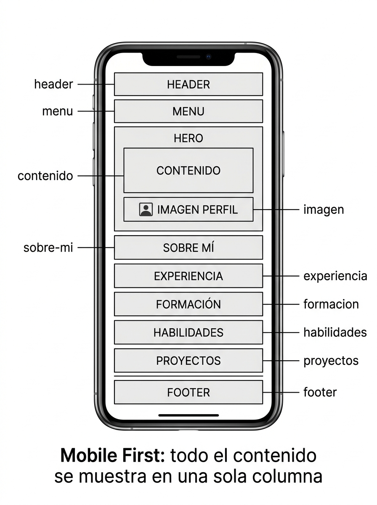
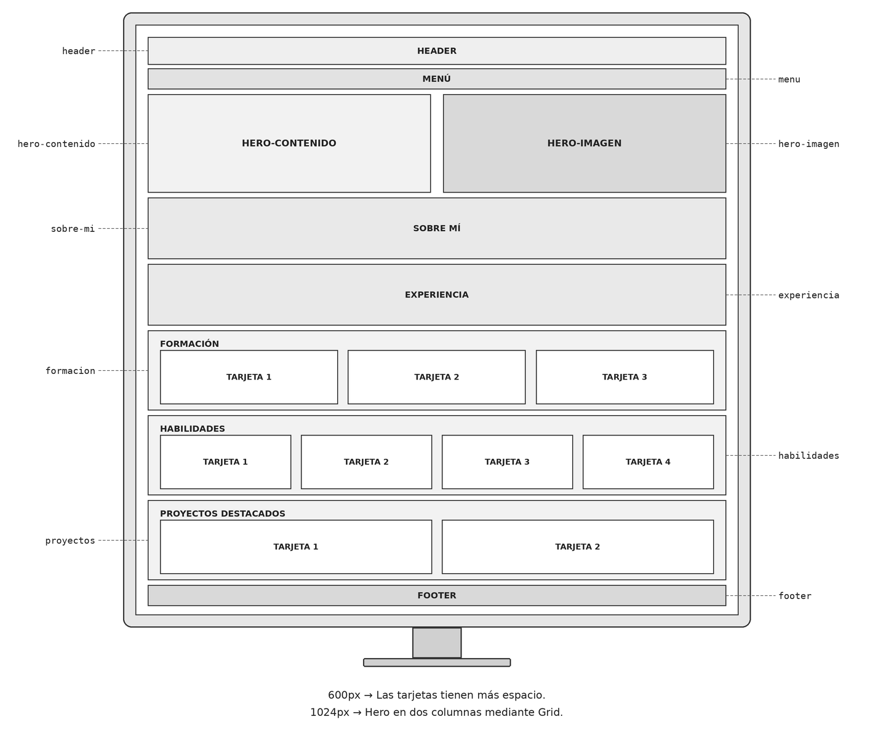
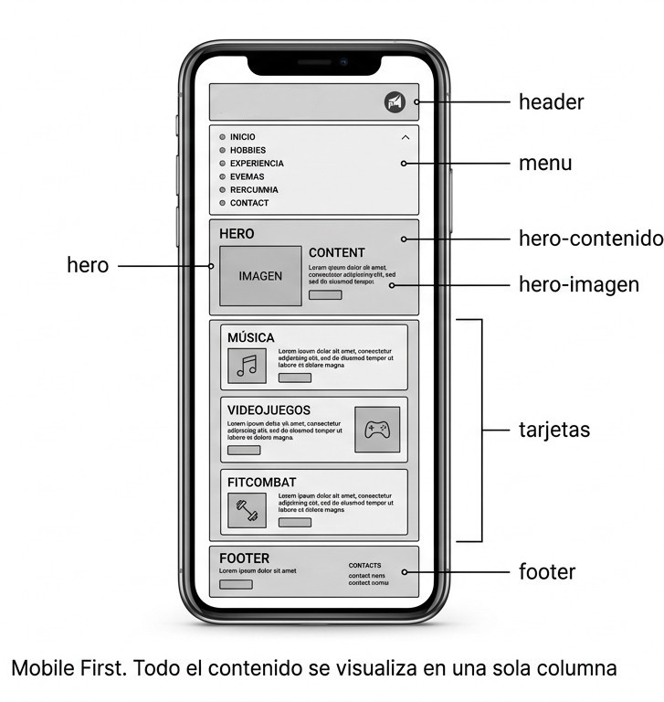
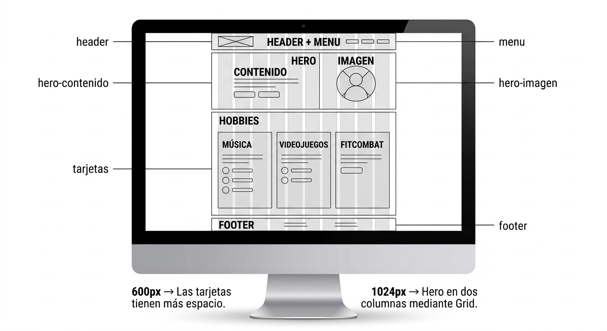
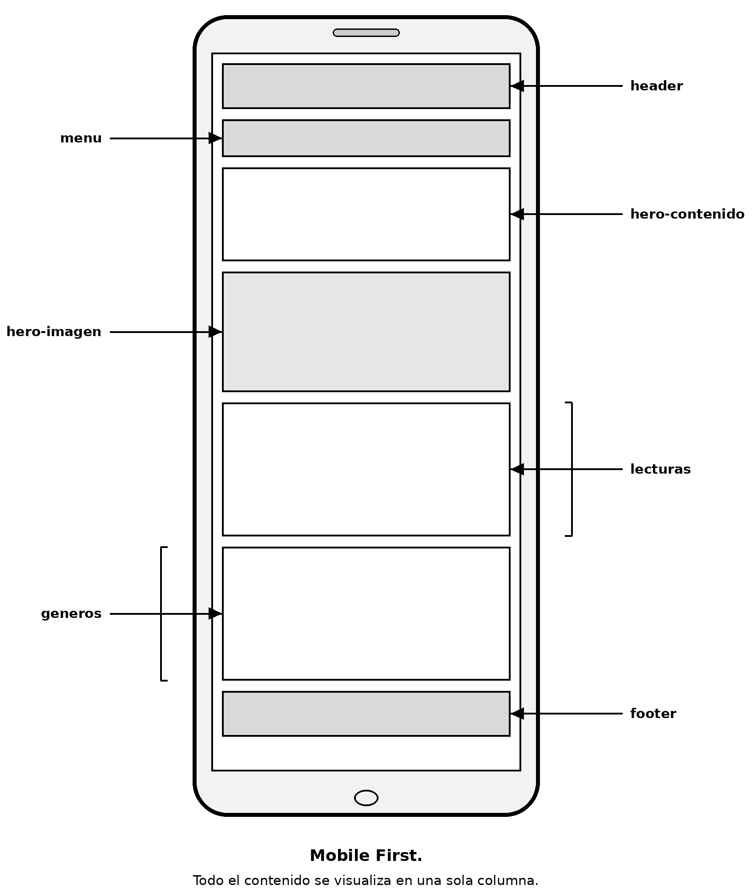
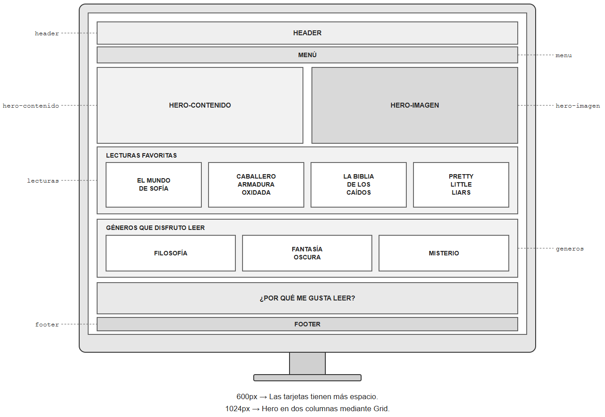
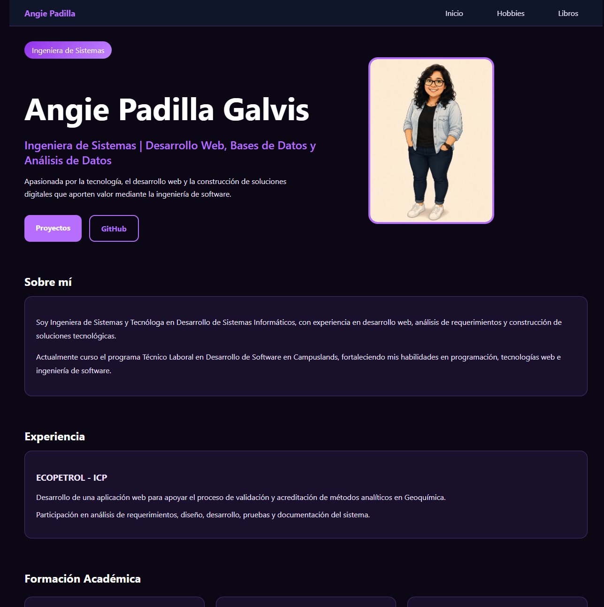

# Hoja de Vida Web · Angie Padilla Galvis

Sitio web personal desarrollado como parte de la actividad "Mi Hoja de Vida Web". El proyecto presenta información profesional, formación académica, habilidades, experiencia, intereses personales y lecturas favoritas mediante un diseño responsive construido con HTML y CSS.

## Sitio publicado

🔗 https://angiepad09.github.io/Hoja_vida_Angie/

## Repositorio

🔗 https://github.com/Angiepad09/Hoja_vida_Angie

---

# Páginas del sitio

## index.html
Página principal donde se muestra mi perfil profesional, experiencia, formación académica, habilidades y proyectos destacados.

## hobbies.html
Página dedicada a algunos de mis hobbies e intereses personales, como la música, los videojuegos y el Fitcombat.

## libros.html
Página donde comparto algunas de mis lecturas favoritas y los géneros literarios que más disfruto.

---

# Mockups

## Inicio

### Versión móvil

### Versión computador

---

## Hobbies

### Versión móvil

### Versión computador

---

## Libros

### Versión móvil

### Versión computador

---

# Capturas del sitio publicado

## Vista desde celular

## Vista desde computador

---

# Breakpoints utilizados

## Diseño base (Mobile First)

El sitio fue desarrollado siguiendo la metodología Mobile First, por lo que el diseño inicial está optimizado para dispositivos móviles y todo el contenido se organiza en una única columna.

## Breakpoint 600px

A partir de los 600px las tarjetas aprovechan mejor el espacio disponible y se distribuyen de forma más cómoda para pantallas medianas.

## Breakpoint 1024px

A partir de los 1024px el Hero cambia de una columna a dos columnas utilizando CSS Grid y grid-template-areas. El contenido principal se ubica a la izquierda mientras que la imagen se muestra a la derecha.

---

# Tecnologías utilizadas

- HTML5
- CSS3
- CSS Grid
- Flexbox
- Media Queries
- Git
- GitHub
- GitHub Pages

---

# Cómo publiqué el sitio

1. Creé un repositorio público en GitHub.
2. Subí todos los archivos del proyecto al repositorio.
4. Fui a Setting -> Pages.
6. En Branch seleccioné la rama principal del repositorio, presione SAVE.
7. Esperé a que GitHub generara el enlace público.
8. Verifiqué que todas las páginas, enlaces e imágenes funcionaran correctamente.

---
No consulte ninguna pagina, Ya tenia conocimientos previos como como se realizaba
la publicación en GitHub Pages. Igualmente dijo la documentacion oficial de Github

# Fuentes consultadas

https://docs.github.com/es/pages/getting-started-with-github-pages/creating-a-github-pages-site

---

# Autor

**Angie Padilla Galvis**

Ingeniera de Sistemas y estudiante de Desarrollo de Software.